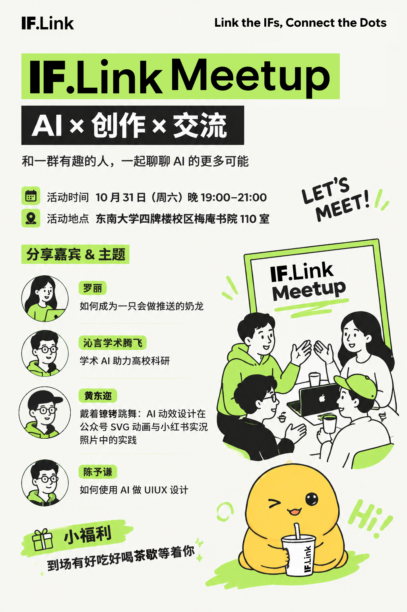
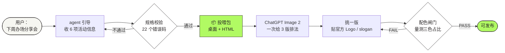

<div align="center">



<h1>IF.Link Meetup 海报 Skill</h1>

<p><b>把一场活动，变成一张能发的海报。</b><br/>
<sub>Say it in one sentence. Get a poster that still looks like it came from the same studio.</sub></p>

<p>


</p>

<sub>奶油白 <code>#F6F6F1</code> · 深黑灰 <code>#242021</code> · 荧光绿 <code>#B1FA63</code></sub>

</div>

---

## 这是什么

一套**给活动海报用的生产规范 + 工具链**。它不是"又一个生图提示词模板"，而是把一次真实生产对话（11 轮、6 次推翻重做）里踩过的坑，固化成可以反复执行的东西：

- **视觉语言锁死**：配色、色块语法、字号层级、手绘质感 —— 保证每期一眼是同一套
- **排版完全放开**：不预设左右分区，交给模型按内容自己排
- **文案零错字**：活动名、时间、地点、嘉宾逐字进清单，成图后逐字核对
- **品牌资产零误差**：Logo 与 slogan 不让模型画，出图后贴官方文件
- **配色可量测**：荧光绿 / 黑 / 奶油白的占比用脚本量，跑偏直接判红

> 它不生成图片。它把"这场活动该怎么画"讲到像素级，然后告诉你去哪儿按快门。

---

## 一句话看懂流程



**人的动作只有三次**：说清活动、挑一版图、把图发回来。

---

## 30 秒上手

```bash
# 1) 环境自检（字体 / 资产 / 桌面可写）
python scripts/doctor.py

# 2) 生成投喂包（默认落在桌面）
node scripts/build-prompt.mjs spec.json --pack
```

然后：

1. 打开桌面上的 `<活动名> 投喂包/`，双击里面的 HTML
2. 把 `01_参考图.png`、`02_Logo.svg`、`03_Slogan.png` 传给 ChatGPT，点「复制提示词」
3. 拿到 3 版海报，挑一版

<details>
<summary><sub>不想记命令？让 agent 问你 —— 展开看对话示例</sub></summary>

```
你：下周办场分享会，帮我做个海报

agent：我做 IF.Link 的系列海报。把这期活动信息发我就行，我给你一个包，扔给 ChatGPT 就能出图。
      需要：活动名、主题行、时间、地点、嘉宾（姓名 + 各自讲什么）、福利。

你：Meetup #17，聊聊 AI 和音乐，12 月 20 号周六下午两点，教三 305。
    嘉宾两个：陈声讲 AI 编曲，徐晚讲生成音乐版权。到场有黑胶唱片抽奖。

agent：（回读确认）… 有要改的吗？没有我就开始做。

agent：📦 投喂包已生成：~/Desktop/IF.Link Meetup #17 投喂包/
       👉 1. 双击里面的 HTML  2. 传三张图、复制提示词  3. 拿 3 版挑一版
```

</details>

---

## 投喂包里是什么

```text
IF.Link Meetup #17 投喂包/
├── IF.Link Meetup #17·提示词包.html   ← 唯一要打开的：上传清单 + 一键复制提示词
├── 01_参考图.png                      ← 只借画风，不借排版
├── 02_Logo.svg
└── 03_Slogan.png
```

HTML 里就五节：**先上传 → 复制提示词 → 出图之后 → 出问题贴哪条 → 验收清单**。
没有命令、没有 JSON、没有技术名词。

---

## 设计约定：锁什么，放什么

系列感来自这四样，**不来自左右分区**：

| 🔒 锁死 | 🔓 放开 |
| --- | --- |
| 三主色 + 单一点缀色、占比 | 分区与构图（左右 / 上下 / 满版 / 网格） |
| 绿块压黑字、黑块压白字的**色块语法** | 插画占多大、压不压字 |
| 字号层级（按画布高度的百分比） | 嘉宾横排还是竖排、几列 |
| 手绘质感：平涂、4–5px 描边、收口略抖、无渐变 | 留白位置；配图内容（从嘉宾话题取材） |

<div align="center">

|  奶油白 65–75% |  深黑灰 8–12% |  荧光绿 8–12% |  点缀色 ≤6% |
| --- | --- | --- | --- |

</div>

点缀色是"这一期"的味道（比如讲奶龙那期用了暖黄），只能出现一种、只落在小角色与涂鸦上。
参考图的橙红 `#FE7733` 不算点缀色 —— 那是照抄。

---

## 11 轮对话换来的 7 条规矩

| 翻车 | 后来怎么写进规则 |
| --- | --- |
| 整版被参考图的橙红带跑 | 色彩锁 + 点名禁用 `#FE7733` + 脚本量测占比 |
| 擅自加了"联合主办" | 元素白名单：不在清单里的一个字都不许加 |
| 标题从「AI × 创作 × 交流」缩成「AI × 交流」 | 逐字清单 + 成图后逐字核对 |
| 「戴着镣铐跳舞」被写成「镲锜」 | 中文固定搭配进校验，生僻字单独提示 |
| 男嘉宾被画成女性 | `gender` 设为必填字段，直接进提示词 |
| 小角色被改成荧光绿、越改越丑 | 角色走局部重绘，且**不参与整版重生成** |
| 每改一处就崩一片 | 锁区域迭代：一轮只改一处，其余冻结 |

其中最后一条最值钱：**"保持整体不变，只修改这一处"** —— 这句话把 6 次全盘推翻压成了 1 次定向修复。

---

## 质量闸门

| 闸门 | 看什么 | 怎么判 |
| --- | --- | --- |
| **G1 内容** | 活动名 / 时间 / 地点 / 嘉宾 / 福利 / slogan | 逐字核对，单字名与生僻字重点看 |
| **G2 配色** | 三主色占比、点缀色种类、有无橙红 | `check-palette.py` 量测，FAIL 不出图 |
| **G3 层级** | 缩到手机 1/3，第一眼是不是活动名 | 肉眼 |
| **G4 字体** | 无衬线、同族、层级不倒挂 | 肉眼 |
| **G5 图形语言** | 直角块、粗描边、无渐变 / 3D | 肉眼 |
| **G6 品牌资产** | Logo 未变形、slogan 大小写正确 | `brand-stamp.py` 贴官方文件后必过 |

```text
$ python scripts/check-palette.py poster.png
  ✅ 奶油白画布    69.3%   区间 55–85%
  ✅ 深黑灰墨色    11.3%   区间 5–18%
  ✅ 品牌荧光绿     7.3%   区间 5–16%
  ✅ 点缀色        4.3%   1 种（青色 2.8%）
  ✅ 参考图橙红     0.0%   上限 3%
  ✅ 判定：PASS
```

---

## 仓库结构

```text
.
├── .dsh/skills/iflink-meetup-poster/   ← Skill 本体（DSH 自动加载）
│   ├── SKILL.md                        主控：触发条件 / 五步引导 / 红线
│   ├── references/                     方法论、视觉体系、入参、提示词、质检、异常
│   ├── assets/reference/               定稿基准、官方 Logo、规范版 slogan
│   ├── templates/                      spec 骨架与样例
│   └── scripts/                        校验 / 出包 / 贴牌 / 验色 / 自检
├── logo&slogan/                        官方品牌素材与字体规范（来源：飞书知识库）
├── 最终版海报.png                       定稿样张
├── tools/                              推送辅助脚本
└── LICENSE                             代码 MIT；品牌资产另议
```

<details>
<summary><sub>脚本各自干什么（点开）</sub></summary>

| 脚本 | 作用 |
| --- | --- |
| `new-spec.mjs` | 人话 / 填表 / 空白骨架 → `spec.json` |
| `build-prompt.mjs` | 22 项校验 → 出整合投喂包（`--pack` 落桌面） |
| `brand-stamp.py` | 盖掉模型画的 Logo，贴官方 PNG + slogan |
| `check-palette.py` | 量测三色占比、点缀色、橙红 |
| `doctor.py` | 环境自检：Python / Pillow / Node / 字体 / 资产 / 桌面 |
| `fonts.py` | 跨平台字体（Win 雅黑 / mac 苹方 / Linux Noto CJK） |
| `make-slogan.py` | 生成规范版 slogan 图 |
| `render-poster.py` | 确定性渲染（零错字，备选通道） |
| `render-images.mjs` | 接图像 API（默认 dry-run，不花钱） |

</details>

---

## 它不做什么

- **不生成图片**：这一环交给 ChatGPT Image 2 / gpt-image / Seedream。没有模型的时候，它出的是包，不是图。
- **不替你判断好不好看**：闸门能拦"颜色跑偏、文字写错、Logo 变形"，拦不住"这张不高级"。
- **不保证一次成片**：生图模型的中文仍不可靠，通常还要 1–2 轮局部修 —— 所以才把返修话术也写进了包里。

---

## 环境要求

| 依赖 | 版本 | 用途 |
| --- | --- | --- |
| Node.js | ≥ 18 | 出提示词包（零 npm 依赖） |
| Python | ≥ 3.9 + Pillow | 贴牌 / 验色 / 渲染 / 自检 |
| 一个图像模型 | — | ChatGPT Image 2（推荐）或 API |

装好后先跑 `python scripts/doctor.py`，全绿再往下。

---

## 沿革

| 版本 | 变化 |
| --- | --- |
| **2.0.0** | 可分发：环境自检、跨平台字体、LICENSE |
| 1.9.0 | agent 引导式交付；包默认落真实桌面 |
| 1.8.x | 产物收敛为一份整合 HTML 包；提示词改"一次给 3 版" |
| 1.7.x | Logo 贴牌；slogan 定案（大写 Dots） |
| 1.6.0 | 提示词分两档：学风格 vs 写死坐标 |
| 1.0.0 | 从 11 轮对话里蒸馏出第一版 |

---

<div align="center">
<sub>

建立在一次真实的生产对话之上 · IF.Link 品牌组 · 2026

<code>Link the IFs, Connect the Dots</code>

</sub>
</div>
