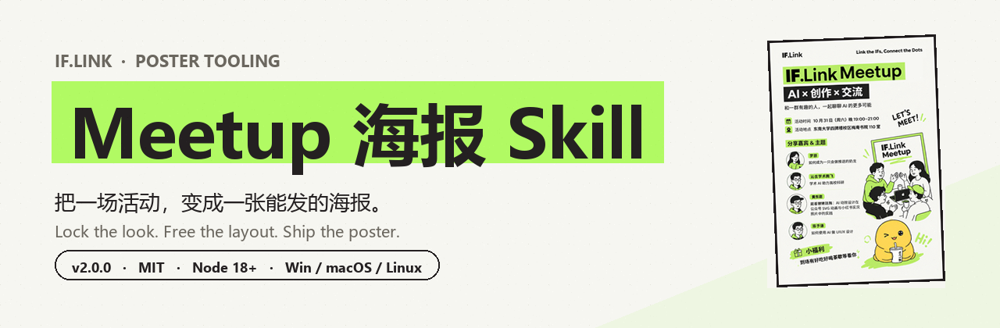
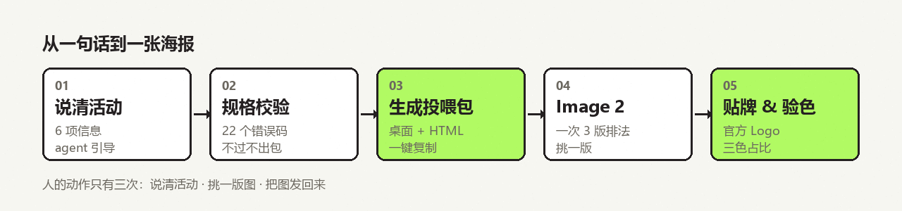
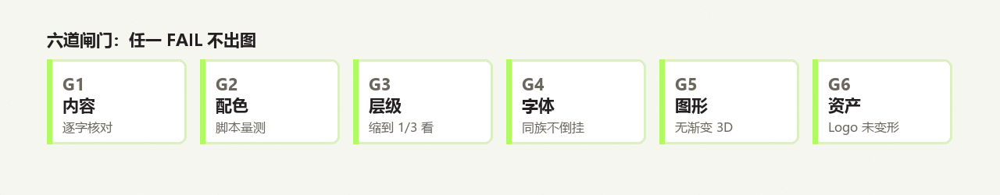

<div align="center">

</div>

<p align="center">


</p>

<p align="center">
<b>输入一句话活动信息 → 得到一个投喂包 → 扔给 ChatGPT 出图 → 贴牌验色 → 发布</b><br/>
<sub>把「每次都要跟设计师来回六轮」变成「一次说清、三版挑一」。</sub>
</p>

<p align="center">
<a href="#-60-秒上手"><kbd>快速上手</kbd></a>
<a href="#-设计约定锁什么放什么"><kbd>设计约定</kbd></a>
<a href="#-六道闸门"><kbd>质量闸门</kbd></a>
<a href="#-它不做什么"><kbd>边界</kbd></a>
<a href="#-faq"><kbd>FAQ</kbd></a>
</p>

---

> **它不生成图片。**
> 它把"这场活动该怎么画"讲到像素级 —— 配色锁、字号层级、文案清单、品牌资产、返修话术、验收标准 ——
> 然后告诉你：去哪儿按快门，以及按下之后怎么判断能不能发。

---

## ✦ 三件事，它做得比人稳

<table>
<tr>
<td width="33%" valign="top">

**🎨 风格不会跑**

主色、色块语法、字号层级、手绘质感全部锁死。
十五期之后，仍然一眼是同一套。

</td>
<td width="33%" valign="top">

**✍️ 文案不会错**

活动名、嘉宾、时间地点逐字进清单，
成图后逐字核对。生僻字单独预警。

</td>
<td width="33%" valign="top">

**📐 颜色可量测**

荧光绿 / 黑 / 奶油白的面积用脚本算，
跑偏直接判红。不靠"我感觉有点花"。

</td>
</tr>
</table>

---

## ✦ 从一句话到一张海报

<div align="center">

</div>

**人的动作只有三次**：说清活动 · 挑一版图 · 把图发回来。中间全自动。

<details>
<summary><sub>▸ 展开看真实对话长什么样</sub></summary>

```
你：下周办场分享会，帮我做个海报

agent：我做 IF.Link 的系列海报。把这期活动信息发我就行，我给你一个包，扔给 ChatGPT 就能出图。
      需要：活动名、主题行、时间、地点、嘉宾（姓名 + 各自讲什么）、福利。

你：Meetup #17，聊聊 AI 和音乐，12 月 20 号周六下午两点，教三 305。
    嘉宾两个：陈声讲 AI 编曲，徐晚讲生成音乐版权。到场有黑胶唱片抽奖。

agent：确认一下这期：
      · IF.Link Meetup #17 ｜ AI × 音乐 × 版权
      · 12 月 20 日（周六）14:00–16:00 ｜ 教三 305
      · 2 位嘉宾：陈声 / 徐晚
      · 福利：黑胶唱片抽奖
      有要改的吗？没有我就开始做。

agent：📦 投喂包已生成：~/Desktop/IF.Link Meetup #17 投喂包/
       👉 1. 双击里面的 HTML  2. 传三张图、复制提示词  3. 拿 3 版挑一版
```

</details>

---

## ✦ 60 秒上手

```bash
# 1) 环境自检（字体 / 资产 / 桌面可写）
python scripts/doctor.py

# 2) 生成投喂包（默认落在桌面）
node scripts/build-prompt.mjs spec.json --pack
```

<div align="center">

</div>

收到的文件夹长这样：

```text
IF.Link Meetup #17 投喂包/
├── IF.Link Meetup #17·提示词包.html   ← 唯一要打开的
├── 01_参考图.png                      ← 只借画风，不借排版
├── 02_Logo.svg
└── 03_Slogan.png
```

HTML 里五节，**没有命令、没有 JSON**：先上传 → 复制提示词 → 出图之后 → 出问题贴哪条 → 验收清单。

---

## ✦ 设计约定：锁什么，放什么

系列感来自这四样，**不来自左右分区**：

| 🔒 锁死 | 🔓 放开 |
| :--- | :--- |
| 三主色 + 点缀色二选一、占比 | 分区与构图（左右 / 上下 / 满版 / 网格） |
| 绿块压黑字、黑块压白字的**色块语法** | 插画占多大、压不压字 |
| 字号层级（按画布高度的百分比） | 嘉宾横排还是竖排、几列 |
| 手绘质感：平涂、4–5px 描边、收口略抖、无渐变 | 留白位置；配图内容（从嘉宾话题取材） |

**五块颜色，各有各的用法：**

| 色 | 值 | 占比 | 用在哪 |
| :--- | :--- | :--- | :--- |
| 🥛 奶油白 | `#F6F6F1` | 65–75% | 画布 |
| ⬛ 深黑灰 | `#242021` | 8–12% | 所有文字、描边、副标题色块 |
| 🟩 荧光绿 | `#B1FA63` | 8–12% | 标题带、区块标、chip、图标、笔刷 |
| 🟧 暖橙 | `#FE7733` | ≤6% | **点缀二选一**：热闹、造物、吃喝、动手 |
| 🟪 淡紫 | `#B2A1FF` | ≤6% | **点缀二选一**：思考、影像、声音、夜 |

点缀色由模型按本期气质挑一个；出现第三种彩色即判 FAIL。

---

## ✦ 11 轮对话换来的 7 条规矩

| 翻车现场 | 后来怎么写进规则 |
| :--- | :--- |
| 整版被参考图的橙红带跑 | 色彩锁 + 橙红只能做 ≤6% 的点缀 + 脚本量测 |
| 擅自加了"联合主办" | 元素白名单：不在清单里的一个字都不许加 |
| 标题「AI × 创作 × 交流」缩成「AI × 交流」 | 逐字清单 + 成图后逐字核对 |
| 「戴着镣铐跳舞」被写成「镲锜」 | 中文固定搭配进校验，生僻字单独预警 |
| 男嘉宾被画成女性 | `gender` 设为必填，直接进提示词 |
| 小角色被改成荧光绿、越改越丑 | 角色走局部重绘，**不参与整版重生成** |
| 每改一处就崩一片 | 锁区域迭代：一轮只改一处，其余冻结 |

最后一条最值钱 —— **「保持整体不变，只修改这一处」**，把 6 次全盘推翻压成了 1 次定向修复。

---

## ✦ 六道闸门

| 闸门 | 看什么 | 怎么判 |
| :--- | :--- | :--- |
| **G1 内容** | 活动名 / 时间 / 地点 / 嘉宾 / 福利 / slogan | 逐字核对，单字名与生僻字重点看 |
| **G2 配色** | 三主色占比、点缀色是否在双色板内 | 脚本量测，FAIL 不出图 |
| **G3 层级** | 缩到手机 1/3，第一眼是不是活动名 | 肉眼 |
| **G4 字体** | 无衬线、同族、层级不倒挂 | 肉眼 |
| **G5 图形语言** | 直角块、粗描边、无渐变 / 3D | 肉眼 |
| **G6 品牌资产** | Logo 未变形、slogan 大小写正确 | 贴官方文件后必过 |

```console
$ python scripts/check-palette.py poster.png
  ✅ 奶油白画布    66.3%  区间 55–85%
  ✅ 深黑灰墨色    11.5%  区间 5–18%
  ✅ 品牌荧光绿     9.5%  区间 5–16%
  ✅ 纯白         3.9%  上限 6%
  ✅ 点缀色面积     3.0%  上限 8%
  ✅ 点缀色合规    淡紫 2.9%（色板：暖橙 #FE7733 / 淡紫 #B2A1FF）
  ✅ 判定：PASS
```

---

## ✦ 仓库结构

```text
.
├── .dsh/skills/iflink-meetup-poster/   ← Skill 本体（DeepSeek Harness 自动加载）
│   ├── SKILL.md                        触发条件 / 五步引导 / 九条红线
│   ├── references/                     方法论 · 视觉体系 · 入参 · 提示词 · 质检 · 异常 · 出图通道
│   ├── assets/reference/               定稿基准、官方 Logo、规范版 slogan
│   ├── templates/                      spec 骨架与样例
│   └── scripts/                        校验 / 出包 / 贴牌 / 验色 / 自检
├── docs/                               README 用图（由 tools/ 脚本生成）
├── logo&slogan/                        官方品牌素材与字体规范（来源：飞书知识库）
├── 最终版海报.png                       定稿样张
└── tools/                              图片生成与推送辅助脚本
```

<details>
<summary><b>▸ 九个脚本各自干什么</b></summary>

| 脚本 | 作用 |
| :--- | :--- |
| `new-spec.mjs` | 人话 / 填表 / 空白骨架 → `spec.json` |
| `build-prompt.mjs` | 22 项校验 → 出整合投喂包（`--pack` 落桌面） |
| `brand-stamp.py` | 盖掉模型画的 Logo，贴官方 PNG + slogan |
| `check-palette.py` | 量测三色占比 + 点缀色是否在双色板内 |
| `doctor.py` | 环境自检：Python / Pillow / Node / 字体 / 资产 / 桌面 |
| `fonts.py` | 跨平台字体（Win 雅黑 / mac 苹方 / Linux Noto CJK） |
| `make-slogan.py` | 生成规范版 slogan 图 |
| `render-poster.py` | 确定性渲染（零错字，备选通道） |
| `render-images.mjs` | 接图像 API（默认 dry-run，不花钱） |

</details>

---

## ✦ 它不做什么

| | |
| :--- | :--- |
| **不生成图片** | 这一环交给 ChatGPT Image 2 / gpt-image / Seedream。没有模型时，它出的是包，不是图。 |
| **不判断好不好看** | 闸门能拦"颜色跑偏、文字写错、Logo 变形"，拦不住"这张不高级"。 |
| **不保证一次成片** | 生图模型的中文仍不可靠，通常还要 1–2 轮局部修 —— 所以返修话术也写进了包里。 |

---

## ✦ 环境

| 依赖 | 版本 | 用途 |
| :--- | :--- | :--- |
| Node.js | ≥ 18 | 出提示词包（零 npm 依赖） |
| Python | ≥ 3.9 + Pillow | 贴牌 / 验色 / 渲染 / 自检 |
| 一个图像模型 | — | ChatGPT Image 2（推荐）或 API |

```console
$ python scripts/doctor.py
  ✅ Python 3.12    ✅ Pillow 12.3    ✅ Node v22
  ✅ 中文字体 微软雅黑   ✅ 拉丁字体 Segoe UI
  ✅ 品牌资产 4 个齐全   ✅ 桌面可写 ~/Desktop
  ✅ 环境齐全，可以用了。
```

---

## ✦ FAQ

<details>
<summary><b>为什么不让模型直接画 Logo？</b></summary>

画不准。字重、字距、比例、`IF.` 与 `Link` 的粗细差，模型每次都会偏一点点。
所以流程是：**出图 → 用画面底色盖掉页眉那条 → 贴官方 PNG**。品牌资产零误差，且可复现。
</details>

<details>
<summary><b>为什么默认要三版？</b></summary>

一版定生死风险太高。三版用不同排法（左右 / 上下 / 满版），画风一致，挑一版再局部修。
比"反复重生一张"快，也更不容易越改越崩。
</details>

<details>
<summary><b>能批量出十几期吗？</b></summary>

能。每期一个 `spec.json`，循环跑 `--pack`；视觉段落完全复用，只有文案不同。
唯一要盯的是嘉宾人数变化（2 / 3–4 / 5–6 的节距不同）。
</details>

<details>
<summary><b>macOS / Linux 能用吗？</b></summary>

能。字体有跨平台解析（苹方 / Noto CJK）；桌面路径也做了兼容 —— Windows 上还会读注册表，
处理"桌面被重定向到别的盘"的情况。
</details>

<details>
<summary><b>为什么仓库里带着品牌资产？</b></summary>

因为它们是生产必需品（定稿基准、官方 Logo、slogan）。代码是 MIT，但 `assets/reference/` 与
`logo&slogan/` 的**品牌资产不在授权范围**，对外分发前请确认对方有使用权。
</details>

---

## ✦ 沿革

| 版本 | 变化 |
| :--- | :--- |
| **2.0.0** | 可分发：环境自检、跨平台字体、LICENSE |
| 1.9.0 | agent 引导式交付；包默认落真实桌面 |
| 1.8.x | 产物收敛为一份整合 HTML 包；提示词改"一次给三版" |
| 1.7.x | Logo 贴牌；slogan 定案（大写 Dots） |
| 1.6.0 | 提示词分两档：学风格 vs 写死坐标 |
| 1.0.0 | 从 11 轮对话里蒸馏出第一版 |

---

<div align="center">

**下一次办活动，别再从头调一遍提示词。**

<sub>建立在一次真实的生产对话之上 · IF.Link 品牌组 · 2026</sub>

<code>Link the IFs, Connect the Dots</code>

</div>
